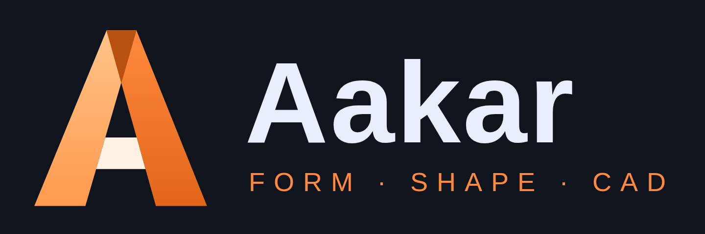

<p align="center"></p>

# Aakar 8.9.0 - Windows desktop build

*Aakar* (आकार) means **form / shape**. The whole application is the single offline file `app/index.html`
(no external libraries). This repository wraps it in Electron so it can be built as a Windows `.exe`.

## What is new in 8.9
**SubD+** tab: live symmetry, edge-loop insert / slide, bevel, bridge, soft selection, lattice deform, per-edge crease sliders, sculpt brushes, thicken / shell, boolean, SubD to NURBS conversion and quad remesh of imported meshes. See [`docs/SUBD_PLUS.md`](docs/SUBD_PLUS.md).

## Earlier: 8.8
**NURBS+** tab: true trimmed surfaces (project, trim, untrim), G0 / G1 / G2 blend and match with a live continuity readout,
curvature comb, zebra stripes and deviation analysis, network (Gordon) and N-sided fills, extend / offset / sew,
curve and surface rebuild, knot insertion / removal and degree change, and fitting a NURBS surface to a point cloud or mesh.
See [`docs/NURBS_PLUS.md`](docs/NURBS_PLUS.md). Earlier: Part+ ([`docs/PART_PLUS.md`](docs/PART_PLUS.md)), Part / Assembly / Sheet metal ([`docs/WORKBENCHES.md`](docs/WORKBENCHES.md)).

## Get the EXE (GitHub Actions - nothing to install)
1. Create a new GitHub repository and upload / push everything in this folder (keep the `.github` folder).
2. Open the repository **Actions** tab -> **Build Aakar Windows EXE**. It runs on push, or press **Run workflow**.
3. When it finishes (about 3-5 minutes) open the run and download the artifact **Aakar-windows**:
   - `Aakar-Setup-8.9.0.exe` - installer (desktop + Start menu shortcut)
   - `Aakar-Portable-8.9.0.exe` - single file, runs without installing
4. Optional: push a tag such as `v8.9.0` and the EXE files are also attached to a GitHub Release.

## Build on your own Windows PC
```
npm install
npm run dist       # EXE files appear in .\dist
npm start          # run without building
```
Requires Node.js 18 or newer.

## Files
| Path | Purpose |
|---|---|
| `app/index.html` | The Aakar application |
| `docs/` | Guides to the Part, Assembly, Sheet metal, Part+, NURBS+ and SubD+ tabs |
| `main.js`, `preload.js`, `prompt*.{js,html}` | Electron shell (window, dialogs, pop-out windows) |
| `build/icon.ico`, `build/icon.png` | App / installer icon |
| `assets/aakar-*.svg / .png` | Logo files (mark, app icon, horizontal logo) |
| `.github/workflows/build-windows.yml` | Builds the EXE on GitHub |

## Project files
- Aakar saves projects as `<name>.aakar.json` (full parametric history).
- Older `.prism.json` / `.prism` projects still open normally.
- Material libraries are saved as `.aakar-mat.json` (older `.prism-mat.json` files still import).

## Updating the app later
Replace `app/index.html` with the newer Aakar html file (keep the name `index.html`),
bump `version` in `package.json`, commit and push - the workflow builds a new EXE.

## Desktop notes
- Works fully offline. `F12` developer tools, `F11` full screen, `Ctrl+Shift+R` reload.
  The menu bar is removed so CAD shortcuts are not intercepted.
- The EXE is not code-signed, so Windows SmartScreen may show "Windows protected your PC" - choose **More info -> Run anyway**.
- Projects opened with the tab arrow (pop-out) open in their own window.
